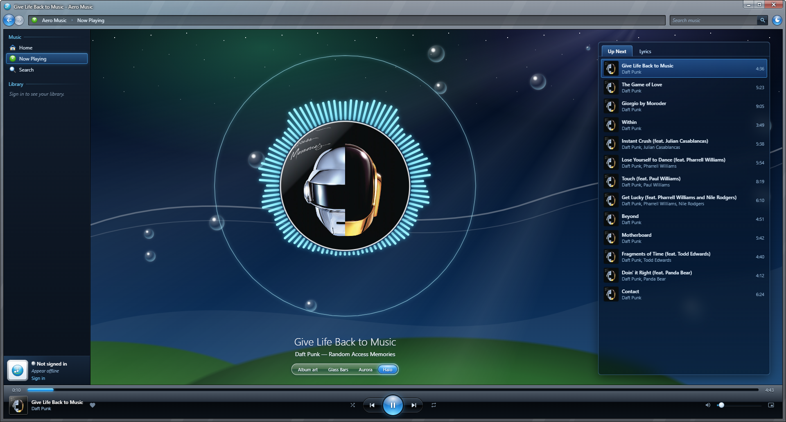
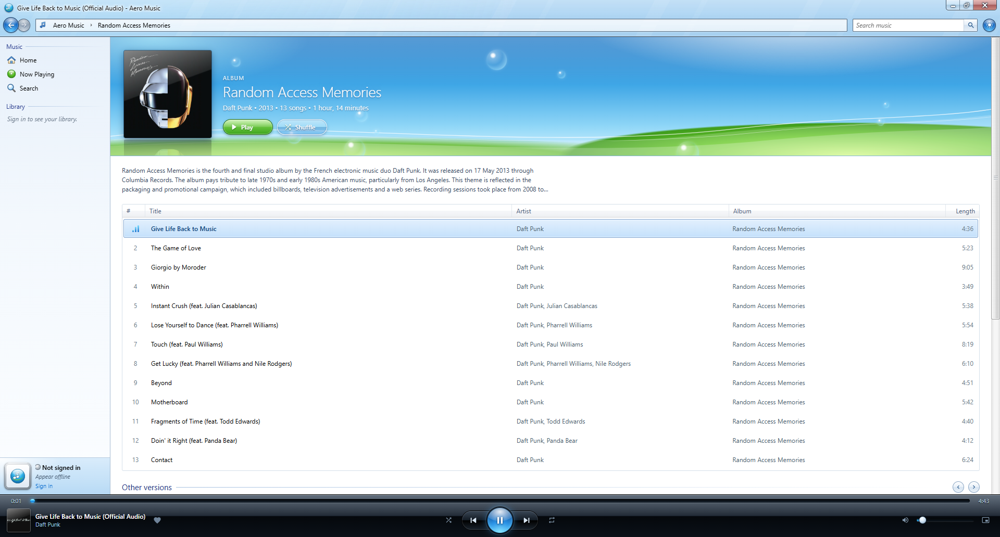
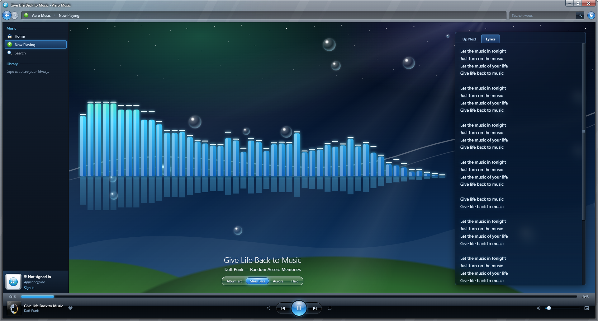
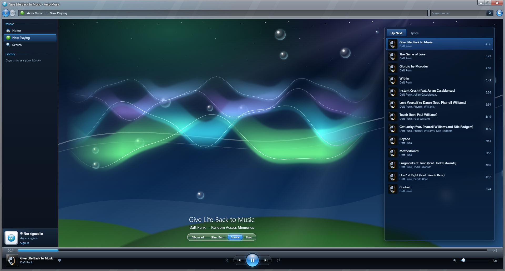

<p align="center">
  
</p>

<h1 align="center">Aero Music</h1>

<p align="center">
  YouTube Music, redesigned in Frutiger Aero.<br>
  Glass, bubbles, glossy orbs, and everything you missed about Windows Vista, WMP11 and MSN Messenger.
</p>

<p align="center">
  <a href="../../releases/latest"><b>Download for Windows</b></a> · <a href="../../releases/latest"><b>Download for macOS</b></a>
</p>





## Features

- **Your YouTube Music, re-skinned:** home, search, albums, artists, playlists, liked songs, lyrics, and Up Next radio, all from your own account.
- **Real Aero glass:** on Windows 11 the window frame blurs whatever is behind it, Vista-style. Windows 10 gets a painted glass frame instead. On a Mac, the frame uses macOS vibrancy behind the glass.
- **Light and dark themes:** a sunny sky-and-green-hills look, or a night sky with aurora. You can also follow your system setting.
- **Visualizers:** Glass Bars, Aurora and Halo, drawn live from the music.
- **Windows Media Player-style controls:** glossy transport bar and a pinnable Mini Player mode. On Windows you also get taskbar thumbnail buttons and a tray icon with a mini-player flyout.
- **At home on a Mac too:** a menu bar icon with the same mini-player flyout, a Dock menu with Play/Pause, Next and Previous, and the music keeps playing in the Dock when you close the window.
- **MSN-style "Now playing" popups** in the corner of the screen when a new song starts.
- **Media keys** work for play/pause, next and previous.

| Glass Bars | Aurora |
| --- | --- |
|  |  |

## Install

### Windows

1. Download the **AeroMusic-Setup** `.exe` from the [latest release](../../releases/latest).
2. Run it. If Windows shows **"Windows protected your PC"**, click **More info → Run anyway**. The app isn't code-signed, which costs money, so Windows doesn't recognise it yet.
3. Open Aero Music and click **Sign in** to use your YouTube Music account.

It installs for your user only (no admin needed), and adds Start menu and desktop shortcuts. To uninstall, go to **Settings → Apps → Installed apps → Aero Music**.

### macOS

1. Download the **AeroMusic-mac** `.dmg` from the [latest release](../../releases/latest).
2. Open it and drag **Aero Music** onto **Applications**.
3. Open Aero Music from your Applications folder. The first time, macOS says it can't verify the app: click **Done**, then go to **System Settings → Privacy & Security**, scroll down and click **Open Anyway** next to Aero Music, and confirm. The app isn't signed with an Apple Developer ID, which costs money, so macOS doesn't recognise it yet. You only have to do this once.
4. Click **Sign in** to use your YouTube Music account.

One download works on both Apple Silicon and Intel Macs. To uninstall, drag **Aero Music** from Applications to the Trash.

**Requirements:** Windows 10 or 11 (64-bit), or macOS 13 Ventura or later. A YouTube Music Premium account is recommended. Without it, ads play like they do on YouTube Music.

## Your privacy

Aero Music has no servers, no analytics and no accounts of its own. It collects nothing.

- **You sign in on Google's own sign-in page.** Aero Music never sees or stores your password.
- **Your sign-in stays on your computer.** Like any browser, the app keeps your YouTube session so you don't have to sign in every time. It's stored locally, in `%APPDATA%\Aero Music` on Windows and `~/Library/Application Support/Aero Music` on a Mac, and only ever sent to YouTube. **Sign out** in the app clears it.
- **Settings stay local too.** Theme, volume and visualizer choices are saved on your computer, in the same folder.
- **The code is all here.** You can read exactly what the app does.

## Keyboard shortcuts

| Key | Action |
| --- | --- |
| Space | Play / pause |
| Ctrl+F / ⌘F, or / | Search |
| Ctrl+← / Ctrl+→ (⌘← / ⌘→ on a Mac) | Previous / next track |
| Alt+← / Alt+→ (Option on a Mac) | Back / forward |
| Media keys | Play/pause, previous, next |

## Build from source

You'll need [Node.js](https://nodejs.org) 20 or newer.

```bash
git clone https://github.com/liyeon-dev/aero-music.git
cd aero-music
npm install
npm start
```

To build the Windows installer (written to `dist/`):

```bash
npm run dist
```

To build the Mac `.dmg` (also written to `dist/`; this one has to be built on a Mac):

```bash
npm run dist:mac
```

It's a universal app for Apple Silicon and Intel, ad-hoc signed rather than signed with an Apple Developer ID.

If you change any icons or installer artwork in `scripts/make-icons.js`, regenerate them with `npm run icons`. That includes the Mac app icon, the menu bar icon and the `.dmg` background.

### How it works

YouTube Music doesn't offer a public API, so Aero Music runs the real YouTube Music web player in a hidden window. That window handles playback and your sign-in, and Aero Music talks to it to fetch your music and control playback. Everything you see is Aero Music's own interface on top.

- `src/main/engine.js`: the hidden YouTube Music window
- `src/main/parse.js`: turns YouTube's responses into simple data for the UI
- `src/renderer/`: the interface (plain HTML, CSS and JavaScript)

YouTube changes its website from time to time, so things can occasionally break until they're patched. If something stops working, please [open an issue](../../issues).

## Disclaimer

Aero Music is an unofficial, fan-made project. It is not affiliated with, endorsed by, or connected to Google or YouTube. "YouTube" and "YouTube Music" are trademarks of Google LLC. Aero Music doesn't download music, block ads or unlock paid features: it's a different look for the YouTube Music you already use.

## License

[MIT](LICENSE)
